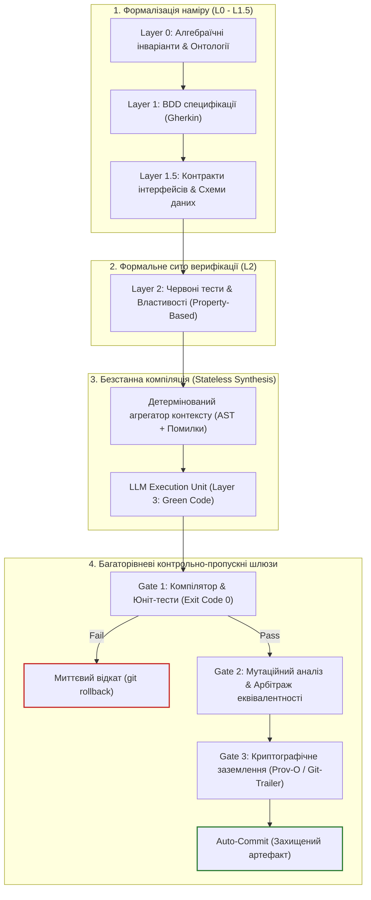

# Експертний відгук та інженерно-методологічний аналіз концепції Intent Compilation Pipeline (ICP)

> **Рецензент:** [Микола Федчик (Mykola Fedchyk)](https://www.linkedin.com/in/nickfedchik/) — системний архітектор, автор монографії *«Архітектура доказових експертних систем: від формальних онтологій до нейро-символьного ШІ»*  
> **Адресат:** Олег Бурлака (Oleg Burlaka) — автор дослідницької ініціативи `deterministic-ai-lab`  
> **Предмет рецензії:** Репозиторій `deterministic-ai-lab`, архітектурний маніфест [ARCHITECTURE.md](docs/ARCHITECTURE.md), опис методології [METHODOLOGY.md](docs/METHODOLOGY.md) та публічний драфт [RFC-0001 (Intent Compilation Pipeline)](docs/rfcs/RFC-0001-ICP-Public-Draft.md)  
> **Дата:** Жовтень 2026 року  

---

## 1. Вступне резюме та концептуальний вердикт

Дослідницька ініціатива **`deterministic-ai-lab`** та запропонований у її межах фреймворк **Intent Compilation Pipeline (ICP)** є надзвичайно своєчасною, актуальною та зрілою відповіддю на системну кризу сучасної генеративної розробки. Практика «вайб-кодингу» (vibe coding), побудована на тривалих неформальних діалогах із великими мовними моделями (LLM), страждає на фундаментальну епістемічну ваду: **невідокремлюваність специфікації від її імовірнісної інтерпретації**.

У класичній інженерії знань та теорії експертних систем цей феномен відомий як **епістемічний розрив** між ймовірнісною правдоподібністю статистичного генератора та детермінованою істинністю формального доведення. Коли людський намір захоплюється контекстом діалогового вікна, виникає катастрофічне накопичення ентропії: втрата першоджерела вимог (*Intent Leakage*), неконтрольований дрейф архітектурного контексту (*Context Drift*) та підміна інваріантів системи випадковими галюцинаціями моделі.

Формула Олега Бурлаки:
> *«Conversation is transient. Intent must be persistent.»*

є бездоганним інженерним гаслом. Ідея трактувати розробку з ШІ як **конвеєр детермінованої компіляції** намірів:
$$\text{Business Intent} \longrightarrow \text{Executable Specs} \longrightarrow \text{Red Tests} \longrightarrow \text{Source Code} \longrightarrow \text{Running System}$$
де кожен наступний рівень є строгішим математичним звуженням допустимого простору станів попереднього рівня, цілком збігається з фундаментальними засадами доказового штучного інтелекту (Evidence-Grounded AI) та формальних методів.

Водночас, аналіз поточного стану репозиторію свідчить про суттєвий **розрив між зрілістю філософського маніфесту та інженерним наповненням кодової бази**. Нижче наведено детальний розбір сильних сторін, виявлених дефектів і розгорнуті рекомендації щодо еволюції ICP у повноцінний промисловий стандарт.

---

## 2. Сильні сторони підходу (Архітектурні досягнення)

1. **Сувора модель розмежування повноважень (Human vs AI Authority Model):**
   У RFC-0001 чітко й безкомпромісно проведено демаркаційну лінію: Людина є єдиним власником наміру, доменних інваріантів (Layer 0), виконуваних специфікацій (Layer 1) та червоних тестів (Layer 2). ШІ повністю усунуто з процесу нормотворення; модель зведена до ролі безстанного компіляційного модуля (Stateless Execution Unit), чия єдина задача — запропонувати мінімальний зелений код (Layer 3), який задовольняє бінарного арбітра (Exit Code 0). Це фундаментальний запобіжник проти автопоетичної деградації, коли ШІ сам собі пише тести й сам же їх успішно проходить.
2. **Мутаційне тестування як другий рубеж верифікації (Gate 2 Resilience via Stryker.NET):**
   Класичний підхід TDD страждає на вразливість «фальшивого зеленого стану»: тест може проходити через відсутність тверджень (`Assert`), тривіальні тавтології чи неповне покриття крайових умов. Інтеграція Stryker.NET як обов'язкового рубежу фіналізації фічі (`run-tdd-cycle.cmd --full`) переводить контроль якості з площини абстрактного тестового покриття рядків (Line Coverage) у площину **доказової стійкості** (Mutation Score). Вцілілий мутант справедливо трактується як потенційний витік наміру (*Intent Leakage*).
3. **Виконувані специфікації як фундамент (BDD via Reqnroll):**
   Використання Gherkin (`.feature`) з автоматичною прив'язкою до кроків Reqnroll змушує фіксувати бізнес-правила не в довільних текстових промптах, а як машиночитні специфікації поведінки, що безпосередньо беруть участь у циклі тестування.

---

## 3. Критичний аналіз поточної кодової бази (Gap Analysis)

Під час детального аудиту файлової структури, вихідного коду та інфраструктури репозиторію виявлено низку суперечностей, які потребують негайної уваги.

### 3.1. Розрив між декларацією в `ARCHITECTURE.md` та фактичною реалізацією
- **Декларація:** В `ARCHITECTURE.md` детально регламентовано промисловий стек: .NET 10, Clean Architecture, CQRS через MediatR, Dapper + PostgreSQL (`IDbConnection`), OAuth 2.0 / OIDC Bearer Tokens з автентифікацією через Keycloak/Entra ID, Swagger з JWT, React + Vite + TypeScript фронтенд, WebApplicationFactory для інтеграційних тестів, Playwright для E2E.
- **Реальність:** 
  - Реалізовано лише ядро домену з трьох сутностей: `Cart`, `CartItem`, `PromoCode` у проєкті `DeterministicAiLab.Domain`.
  - Проєкти `DeterministicAiLab.Contracts` та `DeterministicAiLab.Application` містять стандартні порожні заглушки `Class1.cs`.
  - У проєкті `DeterministicAiLab.Api` методи розширення `AddInfrastructure`, `AddApplicationServices`, `AddAuthenticationAndAuthorization` складаються виключно з коментарів `// TODO: Will be used for...`.
  - Каталогу `src/WebUI` фізично не існує на диску, хоча скрипт циклу містить логіку його перевірки.
  - Проєкти `DeterministicAiLab.Application.Tests` та `DeterministicAiLab.Api.IntegrationTests` порожні.
*Висновок:* Архітектурний опис наразі виглядає як заздалегідь написане технічне завдання, а не віддзеркалення працюючого репозиторію. Це створює враження «фасадного» проєкту.

### 3.2. Сліди неконтрольованої машинної генерації в самому репозиторії
У файлах схеми та наповнення бази даних виявлено прямі артефакти веб-інтерфейсу великих мовних моделей (специфічні теги цитування Google Gemini / NotebookLM):
- [`database/schema.sql`](database/schema.sql):
  ```sql
  code VARCHAR(6) PRIMARY KEY, -- Unique 6-character promo code identifier[cite: 3]
  applied_promo_code VARCHAR(6) REFERENCES promo_codes(code) ... [cite: 3]
  price NUMERIC(18, 2) NOT NULL CHECK (price >= 0), ... [cite: 3]
  ```
- [`database/seed.sql`](database/seed.sql):
  ```sql
  ('SAVE10', 10, '2026-12-31 23:59:59+00'), -- Active valid 10% promo code[cite: 4]
  ('OLDD10', 20, '2025-01-01 00:00:00+00'); -- Expired promo code ... [cite: 4]
  ```
Для репозиторію, чиїм головним маніфестом є «нульова довіра до виводу LLM та сувора перевірка кожної строчки людиною», присутність маркерів `[cite: 3]` свідчить про те, що автор сам скопіював згенерований текст без елементарного санітарного вичитування. Це критично знижує довіру зовнішнього рецензента до строгості заявлених гейтів.

Крім того, у файлі [`tests/DeterministicAiLab.Domain.Tests/CartTests.cs`](tests/DeterministicAiLab.Domain.Tests/CartTests.cs#L53) присутній російськомовний коментар:
```csharp
total.Should().Be(80m); // 100 со скидкой 20%
```
У відкритому інженерному проєкті міжнародного рівня з англомовною документацією подібні артефакти неприпустимі.

### 3.3. Локальна моноплатформність (Windows-Lock)
Автоматизація TDD-арбітражу оформлена у вигляді файлу `run-tdd-cycle.cmd` (Windows Batch). Сучасна екосистема .NET є повністю кросплатформною. Відсутність еквівалентного скрипта для POSIX-систем (`run-tdd-cycle.sh`) та відсутність конфігурації CI/CD (наприклад, `.github/workflows/ci.yml`) унеможливлює використання та верифікацію цієї методології на Linux, macOS чи у хмарних раннерах.

### 3.4. Математичні та доменні неточності
- **Заокруглення фінансових величин:** У методі `Cart.CalculateTotal()` використовується `Math.Round(subtotal, 2)`. У середовищі .NET стандартний виклик `Math.Round` реалізує банківське заокруглення (до найближчого парного числа, `MidpointRounding.ToEven`). У розрахунках комерційних знижок та вартості кошика це призводить до випадкових розбіжностей в 1 копійку між клієнтом, базою даних та платіжним шлюзом. Необхідно явно вказувати режим заокруглення (наприклад, `MidpointRounding.AwayFromZero`), зафіксувавши це в інваріантах домену.
- **Слабкі контракти валідації:** У класі `PromoCode` перевіряється лише довжина `code.Length != 6`, але не валідується алфавіт. Рядок з пробілами або спецсимволами (`"A B! "`) успішно пройде валідацію конструктора, але впаде в базі даних на обмеженні `LENGTH(TRIM(code)) = 6`. Інваріант бази та інваріант домену розсинхронізовані.

---

## 4. Фундаментальні рекомендації щодо розвитку Intent Compilation Pipeline (Погляд з позиції експертних систем)

Щоб трансформувати лабораторний експеримент у потужний, індустріально масштабований фреймворк для Mission-Critical розробки, пропоную спрямувати розвиток ICP за п'ятьма стратегічними векторами.



---

### Рекомендація 1. Еволюція Layer 0–1: Від вільного тексту Gherkin до формальних онтологій та алгебраїчних типів

**Проблема:** Природномовний текст у Gherkin (`.feature`) зручний для людини, проте він сам по собі залишається частково неформальним і допускає семантичну двозначність кроків (semantic ambiguity).

**Рішення з теорії експертних систем:**
1. **Зробити невалідні стани невиразними в типах (Making Invalid States Unrepresentable):**
   Замість примітивних типів (`decimal price`, `string code`) у Layer 0 слід ввести строго типізовані Value Objects на рівні C# записів (`readonly record struct`):
   - `Money` (із фіксованим режимом заокруглення та валютою);
   - `PromoCodeText` (із валідацією регулярним виразом `^[A-Z0-9]{6}$` безпосередньо на етапі ініціалізації фабричним методом, що повертає `Result<T, ValidationError>`);
   - `Percentage` (число в межах $[1, 100]$).
2. **Семантичне заземлення на термінологічну онтологію:**
   Створити файл словника домену (`docs/specs/ontology.json`), де кожен бізнес-термін (`Cart`, `PromoCode`, `Expired`, `Discount`) має фіксований URI та зв'язки. Це дозволить валідувати BDD-сценарії на несуперечливість перед їх передачею в генератор.

---

### Рекомендація 2. Інструменталізація безстанного виклику: Детермінований синтезатор запиту (Context & Prompt Assembler)

**Проблема:** Зараз у методології задекларовано «Stateless AI Execution», але не описано механізм: **як саме інженер передає задачу моделі?** Якщо людина копіює шматки коду руками у вебінтерфейс ChatGPT чи Claude — це ручний суб'єктивний процес, де неминуче виникає прихований стан діалогу та дрейф контексту.

**Рішення з теорії експертних систем:**
Необхідно виключити людину з операції передачі даних моделі, залишивши її лише на етапі рев'ю результату:
1. Розробити локальну CLI-утиліту (наприклад, `scripts/icp-assemble.py` або `dotnet-icp`):
   - Утиліта аналізує поточний стан робочого дерева git.
   - Знаходить змінений файл `.feature` та відповідний червоний тестовий метод у `tests/`.
   - Запускає `dotnet test`, перехоплює стек помилки та діагностику компілятора (Roslyn Diagnostic / xUnit Assert Failure).
   - Збирає мінімальний детермінований контекст (AST залежних сутностей + інтерфейси + сигнатура методу, який треба реалізувати).
2. Пакет передається в LLM через API з параметром `temperature = 0.0` (максимальний детермінізм генерації).
3. Отриманий дифф накладається на файл у `src/`, після чого миттєво викликається арбітражний скрипт.
Це перетворить ICP з теоретичної концепції на **замкнений автоматизований цикл керування**.

---

### Рекомендація 3. Вирішення дилеми еквівалентних мутантів (Mutation Triage Architecture)

**Проблема:** Вимога `dotnet stryker --break-at 100` утилізує жорстке правило: будь-який вцілілий мутант блокує авто-коміт. Проте в будь-якому складному математичному коді (особливо з логічними операціями та межами циклів) виникають **еквівалентні мутанти** (mutants that leave program semantics unchanged). Вимагати від тесту вбити еквівалентного мутанта неможливо математично. У результаті розробник або знижує поріг (наприклад, до 80%), руйнуючи ідею 100% доказовості, або застосовує небезпечні хаки в тестах.

**Рішення з теорії експертних систем:**
Розгорнути дворівневий механізм арбітражу мутантів (Mutant Admission Protocol):
1. **Реєстр допущених мутацій (`stryker.admitted-mutants.json`):**
   Якщо мутант вижив, але розробник довів його семантичну еквівалентність, його хеш ідентифікатора та опис заносяться до версіованого реєстру з обов'язковим формальним обґрунтуванням:
   ```json
   {
     "mutantId": "Cart_cs_line34_BinaryExpression_Mutant",
     "classification": "EQUIVALENT",
     "formalJustification": "Changing '<' to '<=' in boundary check has zero effect because collection size is strictly constrained by upstream invariant P1",
     "approvedBy": "Oleg Burlaka",
     "timestamp": "2026-10-10T12:00:00Z"
   }
   ```
2. **Арбітражний скрипт:**
   Скрипт перевіряє: $\text{Killed Mutants} + \text{Admitted Equivalent Mutants} == \text{Total Generated Mutants}$. Лише за такої рівності видається вердикт `PASS`. Це дозволяє зберегти математичну строгість 100% контролю без блокування інженерного конвеєра.

---

### Рекомендація 4. Доповнення мутаційного сита метаморфічним та властивісним тестуванням (Property-Based & Metamorphic Testing)

**Проблема:** Класичні xUnit-тести спираються на поодинокі приклади (Example-Based Testing: `100 - 20% = 80`). Це залишає широкі прогалини для прихованих мутацій у граничних зонах великих або дробових чисел.

**Рішення з теорії експертних систем:**
1. **Тестування властивостей (Property-Based Testing через FsCheck / CsCheck):**
   Замість статичних чисел формулюються універсальні алгебраїчні інваріанти:
   - *Інваріант монотонності:* $\forall \text{cart}, \forall p \in [1, 100]: \text{CalculateTotal}(cart, p) \le \text{CalculateTotal}(cart, 0)$ (застосування будь-якого промокоду не може збільшити фінальну ціну).
   - *Інваріант невід'ємності:* $\forall \text{items}: \text{CalculateTotal}() \ge 0.00$.
   - *Інваріант ідемпотентності:* Повторний виклик розрахунку без зміни кошика зобов'язаний повертати ідентичне значення.
2. Генератор властивостей генерує сотні псевдовипадкових комбінацій вхідних даних на кожній ітерації, що у поєднанні з мутаційним тестуванням гарантує відсутність «сліпих зон».

---

### Рекомендація 5. Криптографічне заземлення артефактів (Provenance & Traceability via Git-Trailers)

**Проблема:** Як зовнішній аудитор або система безпеки може переконатися, що код у продакшені дійсно був згенерований за процедурою ICP, а не написаний людиною в обхід правил чи не скопійований з невідомого чату?

**Рішення з теорії експертних систем:**
Забезпечити наскрізну криптографічну простежуваність артефактів (згідно зі стандартом W3C PROV-O):
- Під час формування автоматичного коміту (`git commit`) додавати стандартизовані git-трейлери:
  ```text
  feat(domain): implement shopping cart discount application

  Intent-Spec-Hash: sha256:7f83b165... (hash of shopping-cart-policy.feature)
  Test-Suite-Hash:  sha256:4d32a110... (hash of passing tests)
  Mutation-Score:   100.0% (Stryker run #42)
  Compiler-Status:  Roslyn 0 Errors, 0 Warnings
  Pipeline-Verdict: DETERMINISTIC_COMPILATION_PASSED
  ```
Це перетворює історію git-репозиторію на самодостатній аудійований журнал доказів (Evidence Ledger), придатний для сертифікації за стандартами ISO 26262 або DO-178C.

---

## 5. Практичний план першочергових дій (Actionable Roadmap)

Щоб перетворити поточний репозиторій на бездоганну демонстраційну платформу інженерної надійності, автору рекомендовано здійснити наступні кроки:

| Етап | Дія | Очікуваний результат |
| :--- | :--- | :--- |
| **Етап 1: Санітарна гігієна** | 1. Видалити маркери `[cite: 3]`, `[cite: 4]` із `schema.sql` та `seed.sql`.<br>2. Очистити `CartTests.cs` від ненормативних коментарів.<br>3. Усунути розбіжність заокруглення в `Cart.cs` (`MidpointRounding.AwayFromZero`). | Кодова база позбавляється маркерів недбалості й стає референсним зразком чистоти коду. |
| **Етап 2: Кросплатформність та CI** | 1. Написати `run-tdd-cycle.sh` для Linux/macOS.<br>2. Створити `.github/workflows/ci.yml`, де автоматично запускається `dotnet test` та Stryker у хмарному раннері. | Методологія стає відтворюваною будь-яким розробником на будь-якій ОС без прив'язки до Windows. |
| **Етап 3: Перший наскрізний вертикальний зріз** | Реалізувати **один** повний бізнес-сценарій від початку до кінця:<br>`Cart` (Domain) $\to$ `ApplyPromoCodeCommand` (Application/MediatR) $\to$ `CartRepository` (Infrastructure/Dapper) $\to$ `POST /api/cart/apply-promo` (API Endpoint). | Ліквідується розрив між документацією та порожніми проєктами; підтверджується працездатність Clean Architecture. |
| **Етап 4: Інструменталізація безстанного ШІ** | Написати мінімальний CLI-скрипт збирання пейлоаду контексту для LLM за похибкою компілятора та червоним тестом. | Усувається суб'єктивний фактор ручного копіпасту в чати, підтверджується статус ШІ як "компілятора". |
| **Етап 5: Публікація та масштабування** | Оновити RFC-0001 з урахуванням моделі арбітражу мутантів і вийти з публічним інженерним постом (наприклад, на DOU або Habr/Medium). | Закріплення за автором пріоритету розробки методології ICP в українському та світовому інженерному просторі. |

---

## 6. Висновок

Проєкт **`deterministic-ai-lab`** Олега Бурлаки торкається найважливішої проблеми наступного десятиліття в індустрії програмного забезпечення: як зберегти суверенітет людського наміру та детермінізм інженерних систем у добу тотальної експансії ймовірнісних моделей. 

Запропонована автором концепція **Intent Compilation Pipeline** має всі шанси перерости з лабораторного прототипу у визнаний стандарт проєктування надійного програмного забезпечення за умови ліквідації виявлених інженерних розривів та поглиблення формальної доказової бази.

*Відгук складено з повагою до дослідницької сміливості автора та щирим бажанням успіху проекту.*

**Микола Федчик (Mykola Fedchyk)**  
*Автор монографії «Архітектура доказових експертних систем»*  
*Жовтень 2026 року*
